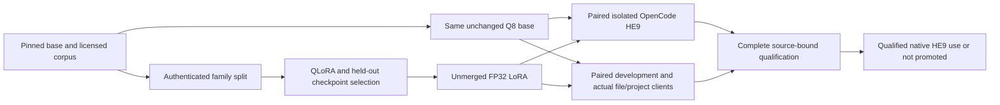

# Qwen3.5-4B: exact Experimentos HE9 replay and corrective tuning

Execution: 7 November 2026, `.54` (`4790`), RTX 3060 12 GB. Training and inference run on .54; the dedicated VM hosts the isolated historical OpenCode harness.

## Decision and measured outcome

**Partial research success; the coding-assistant promotion goal is not achieved.** The earlier MLP is the strongest measured adapter: Base 6/9 → 7/9 and Base+Plus 3/9 → 5/9, while development drops 12/14 → 11/14 and the Hermes project fails. The continuation complete qualifier **rejects invalid compatibility evidence**: Hermes times out and has no complete request attribution after truncated tool output. The table below retains every completed candidate, including rejected or incomplete compatibility evidence. Qualification covers this exact selected historical set and the measured development/client fixtures; it does not establish general coding reliability or frontier-model equivalence.

| Profile | Historical Base | Historical Base+Plus | Finished actors |
|---|---:|---:|---:|
| Base | 6/9 | 3/9 | 7/9 |
| MLP | 7/9 | 5/9 | 7/9 |
| Flow | 6/9 | 4/9 | 8/9 |
| Continuation | 6/9 | 4/9 | 8/9 |

The user selected the nine historical Qwen failures replayed through OpenCode. Their HumanEval task names are retained as identifiers. No new all-164 generation is run for this experiment. The frozen reconstructed Base+Plus grader is not a claim of official EvalPlus parity.

The original MLP has a valid complete **`not_promoted`** decision. The continuation has a valid HE9-only improvement (task 99, no solved-task loss) and 9/14 development success, but its complete qualifier raises `Missing matching actual-client attribution` and writes no complete decision. Its failed controller and raw client record remain unchanged. A completed attempt is not a complete valid compatibility result.

## Community release and next changes

The user explicitly requested publication of the best current improvement and method even if complete qualification fails, and requested no further tuning rounds. The experimental release is [groxaxo/Qwen3.5-4B-WSP-HE9-MLP](https://huggingface.co/groxaxo/Qwen3.5-4B-WSP-HE9-MLP), with the measured PEFT factors, unchanged native F32 LoRA, portable base configuration, model card, method, all candidate outcomes, provenance, source code and attribution. Publication is separate from promotion: the official base remains the selected default, and no global client provider is changed.

The established method authenticates model/data/source/runtime identities, keeps whole task families together, selects by held-out loss before testing, exports unmerged factors against the same Q8 base, replays the fixed historical tasks through real isolated OpenCode, independently grades deadline artifacts, and applies a separate complete coding/tool/client gate. The selected MLP gains two fully solved Plus tasks. Seven additional integration discrepancies and all nine original pipeline discrepancies have regression coverage. These are useful, shareable results, with a bounded evidence claim.

The later all-language adapter and lower-rate MLP continuation are unsuccessful as replacements. Lower held-out losses did not predict a better assistant; the continuation's valid file edits still leave incorrect task-101 logic (`return s.split()` ignores commas), and its development result falls to 9/14. The final Hermes project has an additional output-budget limitation: it omits both output-limit fields, the serving validator falls back to 1,024 tokens, and all 18 rejected tool calls stop at exactly 1,024 with `stop_type=limit`. Their patch calls are incomplete. The 8,192 advertised value is the server cap, not this effective request budget. Preserve the original parser/attribution rejection; it does not establish provider drift or a parser bug. This limits attribution of that failure to training. Changes to data, scope and learning rate in the flow experiment are also confounded.

The output-budget follow-up is now completed: the frontend uses the configured allowance for omitted limits, and both arms are rerun at 28,192 tokens as recorded below. Remaining work is family-disjoint executable coverage, permitted-command/cross-module planning, repeated seeds and unseen repository tasks before promotion. Historical failed artifacts and the strict gate remain intact.

The published PEFT configuration changes only the machine-local base locator and absent revision to the public pinned Qwen ID/revision. The original measured configuration is retained with both hashes; adapter and native bytes are unchanged. A separate CPU shape-only base standard-PEFT preflight verifies all 192 finite FP32 factors load exactly, without claiming new inference quality. The release uses Apache-2.0 with retained model/data notices and corpus attribution. The final delivery manifest records the actual immutable Hub commit and merged Git commit after publication.

## Pipeline and evidence boundaries

The original nine discrepancy fixes remain covered by the full regression suite. Their detailed source/test map and live control are retained in `docs/reviews/20261107-pipeline-fixes.md` and the earlier pipeline-fixes deliverables. The historical 136-test control belongs to its frozen source; the current full suite contains 240 tests.

| Finding | Enforced behavior |
|---|---|
| F01 | One host-wide GPU lock and durable lease; old cleanup cannot restart Bonsai inside a newer GPU phase. |
| F02 | Candidate weights, adapter configuration, training result and actual client requests are bound before acceptance. |
| F03 | Training writes an authenticated recipe archive; checkpoint selection verifies it and publishes atomically. |
| F04 | Fenced examples and valid Python containing tool markup remain literal output; real calls retain strict parsing. |
| F05 | Effective limits, runtime and adapter configuration enter serving identity; a separate nonce identifies each process. |
| F06 | Every indexed weight shard and present loader sidecar must be authenticated. |
| F07 | Nested tool arguments and tool schemas receive delimiter/credential-pattern validation before rendering. |
| F08 | Actual JSON/SSE completion traffic must match the expected model and instance; discovery probes cannot attest a client. |
| F09 | The committed conversion producer creates authenticated manifests consumed by the native supervisor. |

The subsequent HE9 work additionally corrects real sampler forwarding, long-conversation limits, listener readiness, transient GPU admission, unittest-command detection, frontend readiness qualification and deadline finalization. These implementation checks establish the recorded pipeline behavior. Model competence is assessed separately by the measured task and client outcomes below.

## Current project and PR integration

Fetched every branch and PR head, including PRs #1, #2 and #3. PR #1 was already in master. PR #3 head `40fcf3829f01424a0db2545ed0f1bdc36d60c6e6` was integrated into the existing PR #2 branch by merge `1594ffe29a32672dde37d173e6f82bb5ef103acd`. Its cancelled `.51` experiment plan remains cancelled; no `.51` GPU job was started. The nine previously reviewed discrepancies remain covered by regression tests and the historical resolution report.

Implementation commits in this follow-up include `903da9850aef0d160fb1461b8ff4810e509cf20b` (isolated replay and sampler attribution), `334c60017ac6c810a0e45f0f2b3043cb15416be3` (long tool conversations and explicit sampling), and `446c280f26ed524b72ebdc6cc221f9e74f9a6f71` (bounded strict GPU admission). CPU CI for all three passed. Final publication metadata is recorded separately.

A read-only live check at `2026-11-07T01:49:23Z` verified all 96 active source files on both host and VM byte for byte against a clean clone of published commit `446c280f26ed524b72ebdc6cc221f9e74f9a6f71`, including ancestry of the fetched PR heads. The host checkout's metadata still named merge `1594ffe` during inference; its working source was the authenticated published version. The final metadata-only synchronization is recorded separately and does not rewrite training or measurement provenance.

## Exact suite and provenance

Source: private `groxaxo/experimentos`, inspected revision `70e4eabb39c76287f67ce618d27f1c4f7d2ea2d0`, `mimo9b/opencode-he9-2026-10-19/`. The unchanged original files were recovered read-only from `.51` and authenticated. Hidden grader data and canonical reference implementations stay out of the actor and corrective corpus and are not redistributed in Git or the delivery archive.

| File | SHA-256 |
|---|---|
| grade_worker.py | fedd6addd2e03df62f00185ac0f0beb4123f34bc99e731b753076a51bf5392a5 |
| grader-cases-private.jsonl | a9da6444d2142606e0d7ca7f81971f65f595bbb55370e322fc8480c578b18b4d |
| suite-selected.json | e1d7d6e8b79b82ae9649a05db506d2ce40f89401de0067429b5faa6956ea3add |

Tasks: 1, 6, 32, 39, 76, 99, 101, 132 and 141. Their frozen Plus-input counts are 83, 66, 788, 2, 897, 710, 1000, 1000 and 1000: 5546 total. Every public starter is checked byte for byte against the original manifest. All nine archived references pass the base tests and all Plus inputs through the pinned grader.

The original Qwen failures came from Qwen3.6-35B-A3B-Heretic GPTQ-Pro W4/g64/MTP3, single-prompt evaluation (nine failures among 100). They are not a historical matched measurement of this Qwen3.5-4B OpenCode configuration. Historical MiMo OpenCode results were 1/9 for base, 1/9 for checkpoint 300 and 4/9 for final step 473; runtime differences prevent treating those as a controlled comparison here.

The frozen grader is `reconstructed-base-plus-v1`, not certified official EvalPlus parity. Task 32 compares to one canonical root and can reject another mathematically valid root. Keep its frozen verdict and label any supplementary mathematical audit separately.

The archived grader stops at the first failed Base check and skips Plus in that case; otherwise it stops at the first failed Plus input. Thus 5546 is the frozen input inventory, not a claim that every failing model artifact executed every input. All nine passing reference controls do exercise the full inventory. Preserve this original fail-fast behavior and report the recorded executed/passed counts accurately.

## Fresh VM and isolation

Dedicated VM `wsp-he9-clean-20261107`, UUID `6f8b215d-21ba-4297-af5e-3685a6ecc4aa`, 2 vCPU, 4 GB RAM, sparse 24 GB disk, autostart disabled. Verified Ubuntu cloud-image SHA-256: `04e8f2461a16a44e78a370284471f29616cdd9baf1893df25807b71f985b6c94`. Existing personal VMs were preserved.

The virgin-state record was captured before any client/harness installation. It proves absence of prior OpenCode binary/state, Hermes state and harness workspace at that time. Setup controls and failed attempts subsequently created logs on this VM; the report does not claim those attempts never happened. Each actor independently receives fresh tmpfs HOME/XDG, public task workspace, two read-only harness scripts and the model socket. No earlier attempt, private grader, host home, external network, Docker socket or personal profile is mounted. Container inspection and preflight are recorded for every task.

Primary actual CLI: OpenCode 1.19.4, ELF SHA-256 `538fcb1b6408c8d4608822acee19f7ff5b3a3eb3383c0633c4f06170857312a7`. Actor/grader Python 3.11.17, pinned official image `python:3.11.17-slim@sha256:b7a9e5f6a93d6d4a31f129bbd4bdee69efccb6ded0fb230d78aafaf37af98377`. The historical OpenCode 1.18.35 images were unavailable; this runtime difference is explicit.

## Matched inference

Official Qwen3.5-4B revision `851bf6e806efd8d0a36b00ddf55e13ccb7b8cd0a`. Both arms use the same Q8_0 base, SHA-256 `2164b7e8728dc954702d86fe423da3a240964877d3d31b8f6530d38702c38547`. The candidate adds an unmerged FP32 MLP LoRA, scale 1.

Full supported context 262144, client input 253952, output 8192; K and V caches both q8_0; flash attention on; one model slot; no context shift or prompt cache; non-thinking mode. Engine logs verify allocation at 262144 tokens. Allocation does not establish long-context recall/quality at every position.

Fixed general instruct sampler from the pinned publisher model card: temperature .7, top-p .8, top-k 20, min-p 0, presence penalty 1.5, repetition penalty 1, frequency penalty 0, seed 20261106. Defaults are filled server-side, conflicting explicit values rejected, actual native settings verified, and every real CLI response attributed to the expected model, runtime and instance. The native engine additionally reports its default 64-token penalty window (`repeat_last_n: 64`), so this is not a claim of sampler implementation parity with vLLM or another engine. The historical replay used greedy thinking mode and 32768 context; those differences remain disclosed.

Reference: https://huggingface.co/Qwen/Qwen3.5-4B/blob/851bf6e806efd8d0a36b00ddf55e13ccb7b8cd0a/README.md

Each task starts a fresh native model and OpenCode actor. Original actor prompt, 8192 output allowance and 1200-second deadline remain fixed. At the deadline the saved code is graded; completion is reported separately. No unverified OpenCode step limit is assumed. Hidden grading runs in a separate offline container. Model API stays on loopback with an SSH reverse tunnel and task socket bridge.

## All historical task outcomes

| Task | Base | MLP | Flow | Continuation |
|---|---|---|---|---|
| 1 | Base+Plus | Base+Plus | Base+Plus | Base+Plus |
| 6 | Base+Plus | Base+Plus | Base+Plus | Base+Plus |
| 32 | Fail | Fail | Fail | Fail |
| 39 | Base only | Base only | Base only | Base only |
| 76 | Base only | Base only | Fail | Base only |
| 99 | Base only | Base+Plus | Base only | Base+Plus |
| 101 | Fail | Base+Plus | Fail | Fail |
| 132 | Fail | Fail | Base+Plus | Fail |
| 141 | Base+Plus | Base+Plus | Base+Plus | Base+Plus |

The additional-case inventories are fixed, but grading is fail-fast: Base failures skip Plus, and Plus stops at its first failure. The 5,546 total inputs describe the frozen inventory, not the number executed by every model. The original per-case partial results, actor deadlines, errors, times and request counts remain in the raw reports and the primary comparison below.

## Corrective corpus and adapter

928 conversations: 640 pinned public OpenCodeInstruct/Hermes examples plus 288 authored corrective examples (128 executable coding, 160 tool conversations across 18 semantic families). Split 832 training / 96 validation with whole authored families held out. Public-source split remains pinned. All authored coding targets pass independent Docker assertions.

The corrective generator uses development failure patterns; these are tuning data, not independent benchmark proof. It never reads HE9/client fixture files or reference answers. The lexical comparison of 928 prompts against 164 public prompts flagged zero overlap at its declared threshold; this does not prove semantic disjointness or exclude pretraining/public-corpus contamination.

MLP-only LoRA: rank 8, alpha 16, 96 target matrices, learning rate 8e-6, one epoch / 104 steps, gradient accumulation 8, seed 20261107, training sequence length 1536. There are 161047 supervised training tokens and 19116 supervised validation tokens. Training took 1234.7966 seconds. Validation loss improved .29128751158714294 to .19792909920215607. Peak allocated training VRAM was 11102396416 bytes; peak reserved was 12322865152 bytes. The worst-length probe used 1535 tokens and verified finite gradients. Training source/config is archived at run start; later inference changes are not retroactively described as training source.

Training uses NF4 double quantization and BF16 compute, PyTorch 2.11.0, Transformers 5.22.1, PEFT .21.2, bitsandbytes .49.2, flash-linear-attention/fla-core .6.0. `causal-conv1d` is absent and the reference convolution remains enabled. Native Q8 deployment is evaluated afresh; the NF4 training loss cannot certify quality after that runtime change. No library environment was changed during the paired inference run.

Checkpoint 104 was selected by validation before candidate HE9 evaluation. Export has 192 FP32 factors, 36189792 bytes, SHA-256 `b42d8f86daea1caad64dd7b137b41175976f097119f49015d7a2a5b5db6b1611`. Neither training loss nor export integrity is a coding score.

## Per-case results and qualification

Both arms are complete and all nine artifacts are scored, with no unscored infrastructure/API failures. Base: **6/9 Base, 3/9 Base+Plus, 7/9 completed actors**. MLP adapter: **7/9 Base, 5/9 Base+Plus, 7/9 completed actors**.

| Task | Base: Base / Plus | MLP: Base / Plus | Plus passed: base → MLP / inventory | Actor: base → MLP | Seconds: base → MLP | Requests: base → MLP |
|---|---|---|---:|---|---:|---:|
| HumanEval/1 | Pass / Pass | Pass / Pass | 83 → 83 / 83 | finished → finished | 20.894 → 22.153 | 3 → 3 |
| HumanEval/6 | Pass / Pass | Pass / Pass | 66 → 66 / 66 | finished → finished | 17.434 → 21.849 | 3 → 3 |
| HumanEval/32 | Fail / Fail | Fail / Fail | 0 → 0 / 788 | budget_limit → budget_limit | 1200.265 → 1200.153 | 173 → 152 |
| HumanEval/39 | Pass / Fail | Pass / Fail | 1 → 1 / 2 | finished → finished | 22.753 → 24.259 | 4 → 4 |
| HumanEval/76 | Pass / Fail | Pass / Fail | 146 → 47 / 897 | finished → finished | 39.16 → 23.203 | 6 → 3 |
| HumanEval/99 | Pass / Fail | Pass / Pass | 169 → 710 / 710 | budget_limit → finished | 1200.153 → 27.57 | 170 → 4 |
| HumanEval/101 | Fail / Fail | Pass / Pass | 0 → 1000 / 1000 | finished → finished | 19.691 → 20.19 | 3 → 3 |
| HumanEval/132 | Fail / Fail | Fail / Fail | 0 → 0 / 1000 | finished → budget_limit | 29.529 → 1200.158 | 4 → 157 |
| HumanEval/141 | Pass / Pass | Pass / Pass | 1000 → 1000 / 1000 | finished → finished | 49.751 → 54.22 | 7 → 7 |

Base interval: `2026-11-07T01:18:13.468989+00:00` to `2026-11-07T02:14:10.942028+00:00`. Candidate interval: `2026-11-07T02:14:13.452675+00:00` to `2026-11-07T03:10:27.159657+00:00`.

**The all-or-nothing task improvement does not imply improvement on every partial artifact.** Task 76 previously passed 146 Plus inputs before a mismatch; the MLP version passes 47 before the archived per-input deadline. Task 132 previously finished with wrong code; the MLP actor now reaches its 1200-second deadline with wrong code. Aggregate actor completion stays 7/9 because task 99 changes from timeout to successful completion.

The completed base task-32 attempt timed out after 1200.265 seconds with 173 verified streaming requests and no proxy errors. Its saved code failed the original Base checks. A separate, network-disabled Docker audit of the exact candidate SHA `a2014f3f69123c58b7a79de2e32e484f5ab7be4735f6353e0587d4e06b78205d` executed only the two public examples: `[1,2]` returned `0.0` with polynomial residual `1.0`; `[-6,11,-6,1]` returned `0.0` with residual `-6.0`. This is a real solver error, independent of canonical-root matching. The saved solution's bracket condition only enters for one sign orientation and otherwise returns a rounded midpoint. No canonical solution was added to training and this supplementary audit does not modify the frozen verdict.

Base task 39 completed in OpenCode and passed its Base checks, then passed one of two Plus inputs before `plus: Deadline at 1: deadline`. The saved implementation tests odd primality divisors up to a square-root bound. This is the archived per-input time limit, not the actor deadline or a transport failure; both candidate and reference are subject to the same per-input limit. Base task 76 completed and passed Base, then failed after 146 of 897 Plus inputs with `plus: mismatch at case 146`. Its saved implementation uses `math.log`, `math.pow` and an absolute floating-point tolerance for integer powers. These exact failure categories are preserved; no hidden input or canonical implementation is used as a corrective training target.

Base task 99 timed out at 1200.153 seconds after 170 attributed streaming requests, passed Base and 169 Plus inputs, then mismatched at Plus index 169. Base task 101 ended normally at the CLI level but left invalid Python: its edit removed the opening triple quote and retained the closing delimiter, producing an unterminated string. Base task 132 used depth greater than one as proof of completed nesting and rejected a leading unmatched closing bracket, conflicting with the requested valid-subsequence contract.

Independent, offline Docker contract probes confirmed concrete failures without reading canonical implementations or hidden inputs: task 76 returned `True` for `is_simple_power(2**60 + 1, 2)`; task 99 changed the integral decimal strings at positive and negative `2**53` by one; task 132 returned `True` for `[[` and `False` for `][[]]`. Exact candidate hashes and observed/expected values are recorded in `he9-contract-probes-20261107-01.json`. These probes do not change the archived scores and are not imported into corrective training.

The MLP task-32 artifact also returns `0.0` for both public examples, with residuals `1.0` and `-6.0`. Its failure therefore does not depend on the canonical-root ambiguity. MLP task 39 is byte-identical to the base artifact and hits the same second Plus-input deadline. The adapter corrects the task-99 large integral-decimal probes and the task-101 Python syntax failure. Its task-76 implementation uses repeated multiplication and is correct on the independent large-power probe, while remaining too slow on a recorded Plus case. MLP task 132 returns `None` for both independently authored contract probes. These separately named Docker audits neither replace the frozen verdicts nor feed canonical answers into training.

Predeclared gate: all nine fully scored with matched source/tests/runtime/isolation/attribution; strictly more Base+Plus tasks solved; no lost original Base or Base+Plus task; no reduction in completed actors. A tie fails. Independent OpenCode/Hermes development compatibility is additionally required. The comparison utility never changes the running default automatically.

## Paired client and development results

These supplementary installed-client trials on .54 use OpenCode 1.18.32 and Hermes v0.22.2+2320.g27a92f6, installed commit `27a92f6df0644266b3d241f6e33ea162802f7b14`. They are separate from the primary OpenCode 1.19.4 VM replay. Both arms use identical native model/context/Q8/sampling identities, current client harness commit `d143156747499e1c8c9137a209819e28c88cd646`, the same fourteen development fixtures and the same digest-pinned Python 3.12 sandbox. No new all-164 generation is requested.

The completed base phase scores **7/8 coding and 5/6 tools**. Both file clients pass (OpenCode 23.277 seconds, Hermes 58.551 seconds; four attributed requests each). The OpenCode two-module project passes after 681.035 seconds and 51 attributed requests, with observed test execution, independent assertions, verified isolation and no remaining containers. The Hermes project fails after 241.814 seconds and 18 attributed requests; it ran tests but left incorrect code and exited 1. Its failure is retained.

The MLP phase scores **6/8 coding and 5/6 tools**. Both file clients pass (OpenCode 23.368 seconds and Hermes 56.490 seconds; four attributed requests each). The OpenCode project passes in 241.817 seconds with 21 attributed requests and independently verified assertions. The Hermes project fails in 283.030 seconds with 18 attributed requests, exit 1 and observed test execution. Both arms therefore pass both file clients and the OpenCode project, while both fail Hermes's larger project. Its failed development cases are `half_open_overlap`, `bounded_chunks` and `truthful_failure`; `bounded_chunks` is a regression from the base. The first two fail executable assertions; the tool case repeats the same request after an observed failure. The strict promotion gate is unsatisfied. The complete qualifier records 12/14 → 11/14 development success, the `bounded_chunks` regression, passing file clients, a failing project-client aggregate and improved finite validation loss.

The earlier compatibility01 pass was interrupted after a real trace exposed missing support for `python3 -m unittest test_scheduler -v`. The original log gives false with the frozen detector and true with the corrected detector, proven separately in `he9-test-command-detector-audit-20261107-01.json`. Its original OpenCode trial also timed out and failed independent grading, so correcting detection does not change its model-quality rejection. Both complete compatibility arms were restarted in fresh compatibility02 directories. The original evidence was not rewritten. The changed base project outcome across attempts illustrates why one seed and one completed pair do not establish repeatability.

## Additional agent-trajectory experiment

The predeclared follow-up starts only after a complete valid MLP rejection and release of the current GPU phase. It uses 1,184 conversations: the same 928 replay/corrective records plus 256 synthetic read/edit/test/finish trajectories from eight unrelated helper families. All variants, repair states and client interfaces of one family share a task identity. The resulting split is **992 training / 192 validation**, including three newly held-out helper families.

Actual offline Docker controls execute 128 toy fixtures in both broken and fixed states: every broken starter fails and every corrected implementation passes its assertions. Two reduced client-schema representations per fixture produce the 256 trajectories. The trajectories use simulated file-tool feedback and the real separately observed unittest outcomes; they are not real OpenCode/Hermes model scores. A separate schema control verifies the names and argument keys against real OpenCode requests and the exact installed Hermes source. The generator reads neither HE9 answers nor client fixture code.

Generator SHA-256 `e45689c1dabf36f465aae1b3a74e4abae5d48384fcdae457c74abb9d0b442906`; data manifest `5b71c46bac4a5d951e27b2a86cb09d7dd5bbad8ef986e10b3c16b278a73c41fc`; new-trajectory file `132912e8a92599243786e0e7b36c820e9fc8e30c30ee852635a5c46103bc9d45`. The maximum additional conversation is 1,338 tokens. Raw controls and exact prepared data are retained. Fresh control timing text can change a rebuilt dataset hash.

Recipe: all language-layer linear modules, rank 8, alpha 16, learning rate 3e-6, one complete epoch, accumulation 8, seed 20261107 and 1,536-token training limit. The installed Transformers 5.22.1 interprets fractional `warmup_steps=0.05` as a fraction of planned updates: seven warm-up steps for this 124-step run, followed by cosine decay. Training batch size is one, LoRA dropout is 0.05, gradient norm is capped at 1.0 and checkpointing is non-reentrant. Recipe hash `2f00cb419c908c420d0875f5e64501b9727e031db2830d4a4f25d5a431a85a60`. This changes data, adaptation scope and rate together; any result cannot be attributed to only one factor. Checkpoint selection uses held-out loss before testing. Native evaluation then uses the same frozen HE9 protocol and baseline, followed by the complete paired development/client checks. The resumed run records 992/192 usable examples, no dropped conversations, 211,367/52,108 supervised training/validation tokens and 248 adapted linear modules. Its actual 1,535-token zero-learning-rate backward/optimizer probe passes with finite gradients and 11,014,007,296 bytes peak allocated VRAM. Initial held-out loss is 0.38288941979408264; scheduled checkpoints 31, 62 and 93 record 0.33792436122894287, 0.30909234285354614 and 0.2981487810611725. Checkpoint 124 is selected at final held-out loss **0.296787828207016**. The epoch records 2,156.1627 seconds of trainer runtime and training loss 0.27220188033196235; peak allocated/reserved GPU memory is 11,217,448,960 / 12,322,865,152 bytes. The actual HF adapter SHA-256 is `708b65d764f5512c3ee9eae1191a98cbe7aeb3a3abd5b5137c0fa08b08f6b75d`. Native export authenticates 496 FP32 factors with 96 row and 24 column layout transformations, 64,964,608 bytes, SHA-256 `2f863cd342f7f8ff5cbbcdab3281fd171d3c1765d99c9f6cf60129f66eb52c44`. It reuses the exact same Q8 base. The exact HE9 replay is complete in the dedicated VM at 6/9 Base and 4/9 Base+Plus. Development is 11/14; both file clients pass. The original OpenCode project times out at 1,000 seconds and loses its post-run attribution record; Hermes finishes in 213.953 seconds and fails independent tests. The original complete qualifier rejects the incomplete evidence. No model is promoted. These losses belong to the expanded corpus and are not directly comparable to the earlier MLP validation distribution.

## Additional flow adapter: completed historical replay

The full nine-task second-adapter run is complete with valid grading for every saved artifact: **6/9 Base, 4/9 Base+Plus and 8/9 finished actors**. Its native settings, suite, protocol and guest remain the same as the primary pair. The baseline is reused with the recorded unchanged frozen source, rather than regenerated selectively.

|Task|Base pass|Base+Plus pass|Additional cases before first failure|Actor|
|---|---|---|---|---|
|HumanEval/1|True|True|83/83|finished 24.303s|
|HumanEval/6|True|True|66/66|finished 20.44s|
|HumanEval/32|False|False|0/788|budget_limit 1200.168s|
|HumanEval/39|True|False|1/2|finished 26.367s|
|HumanEval/76|False|False|0/897|finished 42.227s|
|HumanEval/99|True|False|169/710|finished 36.651s|
|HumanEval/101|False|False|0/1000|finished 21.5s|
|HumanEval/132|True|True|1000/1000|finished 505.807s|
|HumanEval/141|True|True|1000/1000|finished 54.958s|

Task 132 passes all 1,000 additional inputs after 505.807 seconds. Task 32 still reaches the 1,200-second actor budget and fails Base. Task 76 now fails Base, task 99 again stops at additional case 169, and task 101 contains an unterminated triple-quoted string. The newly solved task 132 does not compensate for the lost base task under the predeclared no-regression rule. All failed artifacts and tool logs are retained; no verdict is rewritten. The original real-client outcomes and missing-proof rejection are retained in the client-finalization section.

## Fresh corrected-source baseline compatibility

The complete baseline arm at `c2b4ed0` reproduces **12/14 development cases:7/8 coding and 5/6 tools**. Both actual file clients pass: OpenCode22.172 seconds/four attributed requests and Hermes58.683 seconds/four requests. The two-module OpenCode project passes in 134.196 seconds with 14 attributed requests, an observed test command, all independent assertions completed and no remaining containers. Hermes finishes in 251.721 seconds with 18 attributed requests and an observed test command, but exits1 and fails independent assertions. Its public trace also repeats diagnostics blocked by the unchanged noninteractive approval policy.

Both project rows confirm own labeled containers stopped before snapshotting. There are no provider-drain or cleanup errors. Their model/runtime identity matches the original primary HE9 base; the fresh process nonce is independently attributed. These new measurements form the complete compatibility reference for the continuation. They are not merged with the older compatibility02 source or used to overwrite it. Timing/request differences are single observations with changing tool feedback, not evidence of a causal speedup.

## Authenticated MLP continuation

The continuation starts from the authenticated MLP parent with a **new optimizer**: rank 8, alpha 16, MLP-only scope, learning rate 2e-06, one epoch, accumulation 8, seed 20261107, and 1536-token training budget. Inference retains the separate full 262,144-token context and Q8 K/V cache.

The corpus has 1,696 conversations, split 1,312 training / 384 validation. The 512 new exact-edit/once-only-observation trajectories have maximum length 1,366 tokens; no usable conversation is truncated or dropped. Supervised token totals are 280,999/96,796. All variants, repair states and client interfaces of each semantic toy family retain one task identity and split.

Training examples are development-informed. Exact string edits are grounded in observed file contents, including complete valid function/docstring replacements. Run-once observations copy actual test failure/error counts. File API feedback is simulated; unittest outcomes are separately observed offline Docker controls. HE9 and acceptance-fixture answers are excluded from the training data. These controls are distinct from real CLI scores.

Parent recipe, files, base, rank, scale, scope and full module targets authenticate. PEFT's saved compact target suffixes are checked as a summary; injection uses the current model's full target list, and exact tensor keys/shapes/dtypes/values are required. The actual Qwen run loads all 192 FP32 parent factors exactly before the 1,535-token zero-rate backward/optimizer probe, which has finite gradients and peak allocated memory of 10,985,253,376 bytes.

Source `c2b4ed05f1b7fd0ff959f85950d76f7310cdb322`; config SHA-256 `79e312004de84a925abf19021fd6d2ec304d884389eb684ab6a87398aaed5bb7`; dataset manifest `0c399f88b33f002fbfd9668f5a9041b29df13feb62b8dcea6c2601e7d4d97de7`; generator `ea05f5982defe6e6ecb29e5b317778f9eeec2c1e97587269e2ff2f476dcef1ea`.

| Held-out evaluation | Loss |
|---|---:|
| Initial | 0.23910367488861084 |
| Step 41 | 0.221535325050354 |
| Step 82 | 0.21199829876422882 |
| Step 123 | 0.20743966102600098 |
| Step 164 | 0.20672309398651123 |

The selected checkpoint is `/home/op/work/weight-space-programming-20261106/runs/he9-continuation-train-20261107-01/training/checkpoints/checkpoint-164` at held-out loss 0.20672309398651123. Trainer runtime is 3075.0394 seconds; training loss is 0.20473693020460082. Peak allocated/reserved VRAM is 11,102,424,064/12,322,865,152 bytes. The saved HF factor checksum is `abf4e038037dcfab712d313e58081cefe3a9e748b8bc666dea541beb36054f6a`. Checkpoint selection uses held-out loss before any native model test.

The authenticated native export contains 192 finite FP32 factors, 36,189,792 bytes, SHA-256 `fb44346c9234d41686fbae7f330e4b62058b2b0205928f9f9df8ed4b290131ad`. Recorded layout permutations: `{'rows': 0, 'columns': 0}`. It reuses the identical Q8 base and is tested as a separate native inference profile.

The installed Transformers 5.22.1 interprets warmup_steps=0.05 as nine warm-up updates for this 164-step run. Each scheduled evaluation covers all 384 held-out conversations. Losses are compared within this split and cannot be compared directly with the older MLP/flow validation distributions. A lower loss alone never qualifies an adapter.

## Continuation coding, tool and actual-client outcomes

Development scores: `{'code': {'passed': 4, 'total': 8}, 'tools': {'passed': 5, 'total': 6}}`. Newly passed cases versus the fresh baseline: `[]`. Lost baseline cases: `['stable_partition', 'merge_counts', 'bounded_chunks']`. These are development-informed measurements; the complete source-bound gate also requires every actual client trial.

| Case | Category | Base | Continuation |
|---|---|---|---|
| adjacent_runs | code | Pass | Pass |
| nested_lookup | code | Pass | Pass |
| stable_partition | code | Pass | Fail |
| half_open_overlap | code | Fail | Fail |
| escape_fields | code | Pass | Pass |
| merge_counts | code | Pass | Fail |
| version_tuple | code | Pass | Pass |
| bounded_chunks | code | Pass | Fail |
| read_and_ground | tools | Pass | Pass |
| dependent_calls | tools | Pass | Pass |
| recover_from_error | tools | Pass | Pass |
| untrusted_file_text | tools | Pass | Pass |
| truthful_failure | tools | Fail | Fail |
| structured_arguments | tools | Pass | Pass |

| Fixture | Client | Result | Seconds | Attributed requests | Independent checks |
|---|---|---|---:|---:|---|
| File | opencode | Pass | 27.082 | 4 | Pass |
| File | hermes | Pass | 66.64 | 4 | Pass |
| Project | opencode | Fail | 1000.001 | 82 | Fail/incomplete |
| Project | hermes | Fail | 1000.001 | Missing | Fail/incomplete |

The raw records preserve exit codes, deadlines, model/instance proof, observed test commands, source/tests checksums, inspected containment and scoped cleanup. A passing client must finish and pass the independent assertions; a timeout remains failed even when its final issued request is drained and attributed. Any incomplete attribution invalidates complete qualification rather than becoming a model success.

## Rejected and interrupted attempts

Preserve these separately from the completed pair:

1. Old NF4 follow-up: stopped when the user selected exact HE9 instead of a new all-164 run. Partial generations are not a complete score; queued controllers were stopped before training.
2. Initial max-context preflight: strict admission rejected occupancy, not an OOM. The next preflight allocated full context/Q8 and returned READY.
3. Thinking HE9 attempt / two diagnostics: the base ended with a tool call inside an unterminated thinking block. Strict parsing rejected it. An independent TIME_WAIT listener-readiness bug was corrected with real-socket tests.
4. Non-thinking greedy attempt: repeated the same failing command despite real tool feedback; interrupted to correct the sampler configuration. Native request construction had hardcoded some settings and dropped the seed. A real HTTP regression reproduced that defect; engine-verified fixed sampler replaced it for both arms.
5. Sampled pair 03: tasks 1 and 6 passed; task 32 looped until the old 200-message API guard rejected it at about 12K tokens. Fixed message count to respect configured context while retaining the 2 MiB body and exact rendered-token guards. A real 202-message request returned READY afterward.
6. Pair 04: task 1 passed, then two successive readiness/admission GPU probes disagreed after pausing Bonsai. Native admission now retries the same strict 10500 MiB / zero-utilization probe for at most 60 seconds; persistent occupancy, unknown layouts and unknown jobs are not bypassed.
7. Synthetic OpenCode step-limit experiments did not establish enforcement in the installed release. They contain no Qwen inference and are neither model scores nor a claimed upstream bug. No additional step cap was added to the benchmark.

Pair 05 is the new full matched run after these corrections. Every old source, log, partial candidate and failure verdict remains retained.

## Readiness-contract correction

The first post-client controller stopped before training because the new qualifier incorrectly required the native backend's `status: ok` field in the frontend's health record. The frontend actually returns its model-discovery body: one configured model, `wsp` identity and `wsp_instance`. Both real model identities were already exactly correct. An HTTP regression using the actual `serve_coder.handler_for` reproduced the false rejection before correction. The corrected gate validates the real discovery body and still rejects missing, duplicate or substituted models and missing/changed instances. A full check of the immutable real pair then returns `not_promoted`, for model quality rather than malformed evidence.

Commit `db1edf497e64d37ffa7a4d5eab08a68940eb651b` passes **225 full .54 tests with pinned Docker and zero skips** in 43.891 seconds, and CI `42338059544` succeeds. Host Git metadata was advanced with byte-verified ref/index updates to that commit, verifying all 102 tracked files. The original failed pre-training controller/error and both complete paired phases remain unchanged. Fresh resume controllers use the same data, recipe and as-yet-unused training output; no earlier training run is replaced. The completed qualification continues to authenticate primary HE9 source at `446c280` and measured client source at `d143156`; the four measured client/development files are byte-identical in the resumed source.

## Client finalization failure and correction

The additional flow adapter's OpenCode project reaches the unchanged 1,000-second client deadline. The CLI process stops while its final issued provider request is still finishing. The original harness calls the single-threaded frontend's model-discovery endpoint immediately; its ten-second timeout expires behind that completion. The saved row has no model attribution or independent grading. Hermes then finishes in 213.953 seconds with 18 attributed requests, an observed test command and failing independent assertions. Both trial labels are cleaned up and Bonsai is restored at 2026-11-07T06:17:02.485524Z. The complete qualifier rejects the missing proof; the failed controller/record is preserved. The original nine-task replay remains fully valid and independently returns not_promoted because task 76 regresses.

Two real-HTTP controls reproduce the race against the original source. A synthetic timed-out actor leaves a delayed request at a single-threaded provider; model discovery fails before correction. The fix drains already-issued requests before discovery in both file and project harnesses. The project harness also stops only its own uniquely labeled containers before hashing source and running independent checks, addressing a cleanup-ordering weakness found in review. The controls prove the delayed request remains attributed, the actor's elapsed time/timeout verdict stays unchanged and failed, and a simulated still-running container cannot mutate the graded snapshot. These are transport/lifecycle controls, not measured Qwen scores.

A fresh complete native baseline compatibility arm and the continuation compatibility arm use the corrected exact same source, C2b. The original valid base/MLP compatibility02 measurements remain separately frozen. The incomplete flow trial is not repaired by fabricating attribution, changing a verdict or copying a newer model identity. The primary nine-task actor/inference protocol remains frozen at 446c280 and is reused unchanged.

## Validation and resource disposition

The full measured source passes 240 .54 regressions with actual pinned Docker and zero skips in 39.121 seconds; CI42347035658 succeeds. Earlier controls remain attached to their own immutable sources rather than relabeled as current.

Point-in-time cleanup proof at `2026-11-07T09:02:38.324579+00:00` verifies clean source `c2b4ed05f1b7fd0ff959f85950d76f7310cdb322` (108 tracked files), no coding listener on 18084/18085, no GPU-owner lease and no remaining owned project containers. Bonsai is active and its own service process returns HTTP 200 / status ok. All seven protected Bonsai/Moss directories exist.

Only dedicated VM `wsp-he9-clean-20261107` (UUID `6f8b215d-21ba-4297-af5e-3685a6ecc4aa`) was gracefully shut down after its scoped guest evidence was captured. Its disk is preserved. Filesystem free space is 16,247,828,480 bytes; HF cache cleared: `False`. Personal VM configuration and canonical MemPalace state are preserved.

GPU phases temporarily paused Bonsai under explicit leases and restoration callbacks. Earlier inactive/restoration exceptions remain recorded; this report does not claim continuous service uptime. The final documentation commit, its CI and a fresh published-source host proof are delivered separately after publication.

## Source publication and evidence

The executed continuation/client-finalization source is `c2b4ed05f1b7fd0ff959f85950d76f7310cdb322`: 240 full .54 tests with actual pinned Docker, zero skips, 39.121 seconds; GitHub Actions run 42347035658 succeeds. All 108 tracked source files were byte-verified on .54; all 95 non-Markdown source/configuration files match the successful tested checkout. The original measured HE9 source remains 446c280 and the original paired compatibility source remainsd143156. The new baseline/continuation compatibility source isC2b. Final documentation publication, CI, source archive and host-state proofs are recorded separately in the delivery manifest. Hidden grader inputs, reference implementations, model binaries, private keys and personal client profiles are excluded from the public Git report and delivery archives.

## Subsequent 28,192-token client follow-up

The paired 28,192-token client rerun records base **3/4** and released MLP **3/4** passes. All actual clients have complete request attribution: **True**. The omitted-limit fallback is fixed, native output allowances are verified, and the original HE9 measurements retain their separate 8,192-token identity. No additional training or model promotion is performed.

The complete [follow-up report](hermes-output28192-20261107.md) and [raw paired evidence](hermes-output28192-20261107.json) retain every new result. Source `4feadcc8216c7953e6a4e2c2643457be0029bfc6` passes 243 full .54 tests with zero skips. The original continuation failures above remain unchanged; the new run uses the released MLP instead of that weaker continuation.
